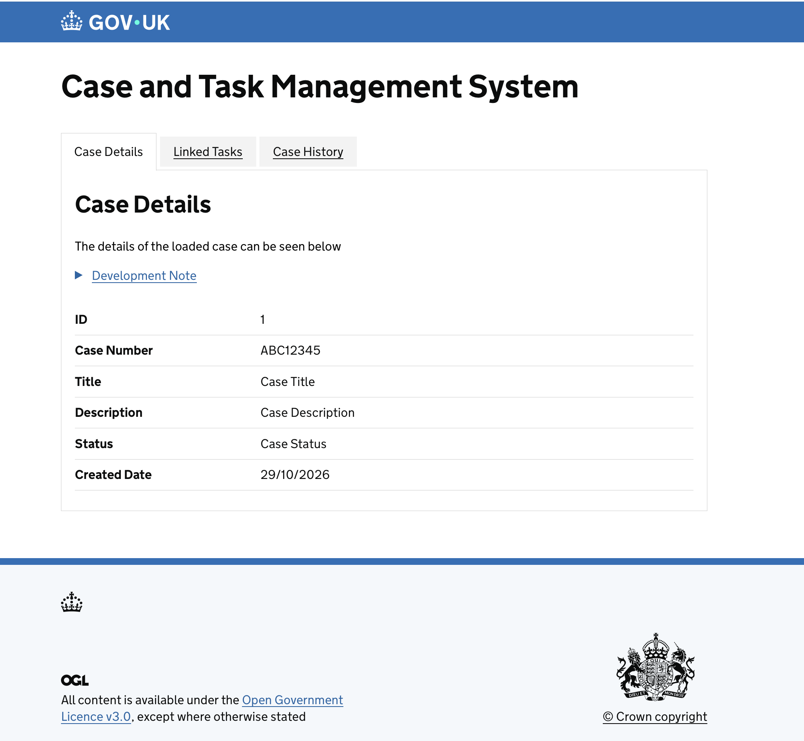
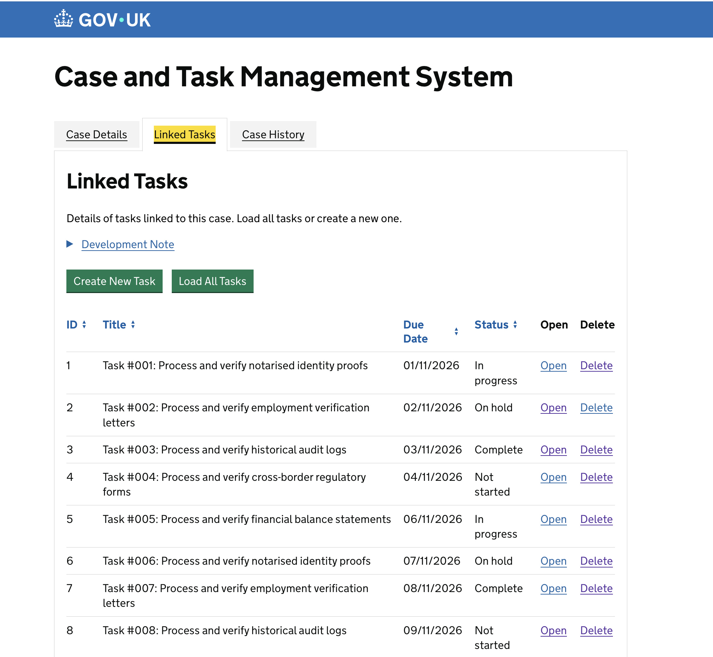
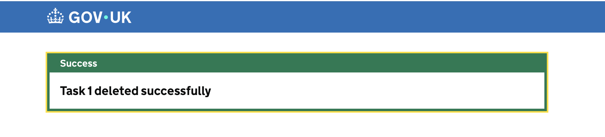
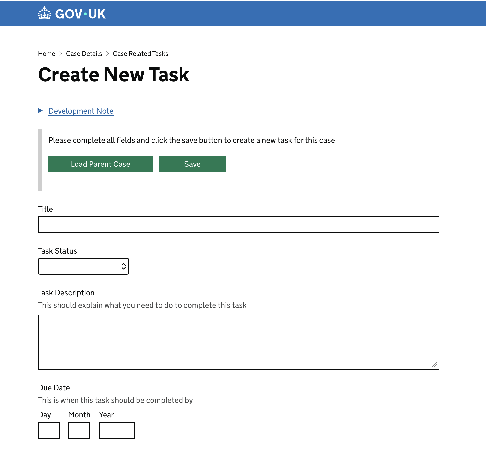

# HMCTS Developer Challenge

A case and task management application with a Java/Spring Boot backend and a TypeScript/Express frontend. The frontend uses GOV.UK Frontend and Ministry of Justice Frontend components, including GOV.UK controls and sortable tables.

## Screenshots

Here are some screenshots illustrating the use of the Gov Uk Design System (https://design-system.service.gov.uk)









## Prerequisites

- Java 21
- Node.js 18 or later
- Yarn 4.16.0 (the frontend package manager)

## Run locally

Start the backend first. From the repository root:

```sh
cd backend
./gradlew bootRun
```

The backend API runs at `http://localhost:4000`.

In a second terminal, install and build the frontend, then start its development server:

```sh
cd frontend
yarn install
yarn build
yarn start:dev
```

Open `https://localhost:3100`. The development server generates local SSL options when it starts; accept or trust the local certificate if your browser prompts you.

## Tests and checks

Run backend tests:

```sh
cd backend
./gradlew test
```

Run frontend unit tests and route tests:

```sh
cd frontend
yarn test:unit
yarn test:routes
```

Build and type-check the frontend:

```sh
cd frontend
yarn build
yarn tsc --noEmit
```

## Project structure

- `backend/` - Spring Boot API and task model/repository
- `frontend/` - Express routes, Nunjucks views, and frontend assets

Task data is currently held in an in-memory repository and is reset when the backend restarts.
